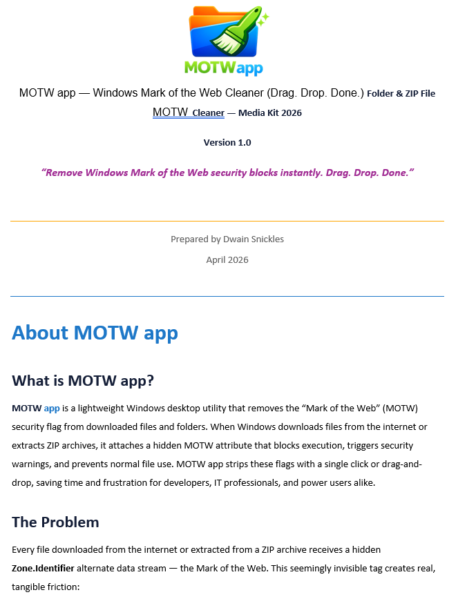
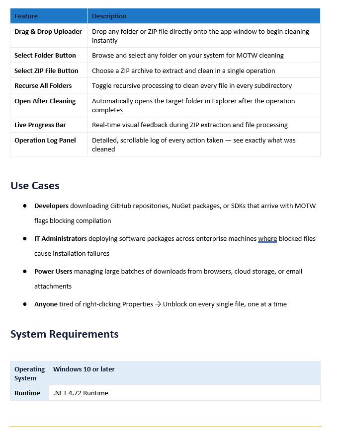
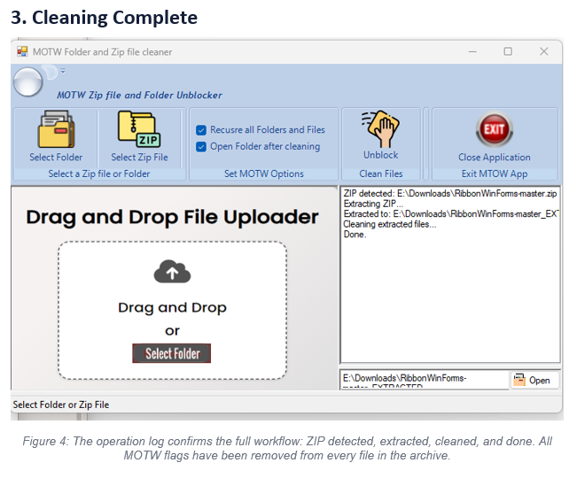
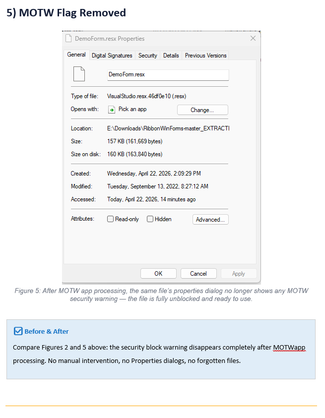
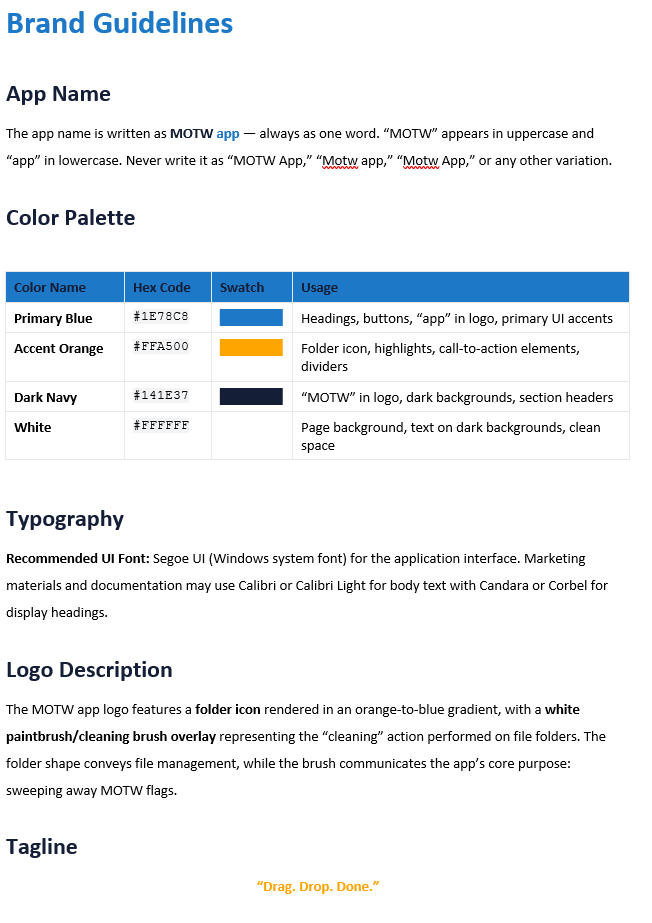

For comments, help, or improvements, use the button below:

## 📧 Email Author

## 📄 View What's New

## 📥 Download and Install MOTW Cleaner Version 1.3.1.0 on your Windows PC.

Windows Installer package (`.msi`) — installs for all users into `Program Files`, adds Start menu and desktop shortcuts, and registers in Apps & features.

## 📦 Portable Version — no install required

Single self-contained `.exe` — unzip and run on any Windows PC, no .NET install needed. Settings and recent folders are stored in a JSON file next to the exe.

# MOTW Cleaner

💡

💡

💡

💡

💡

💡

💡

💡
