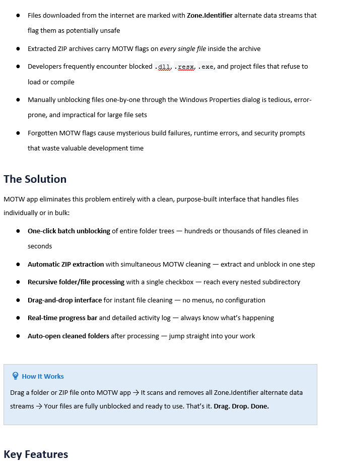
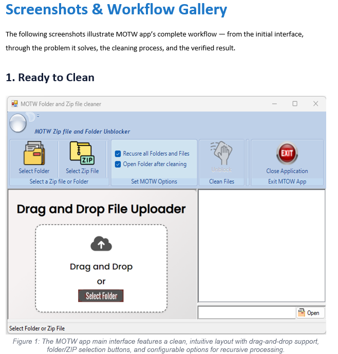
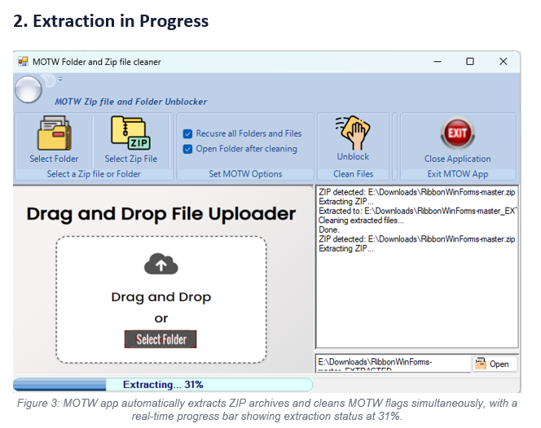
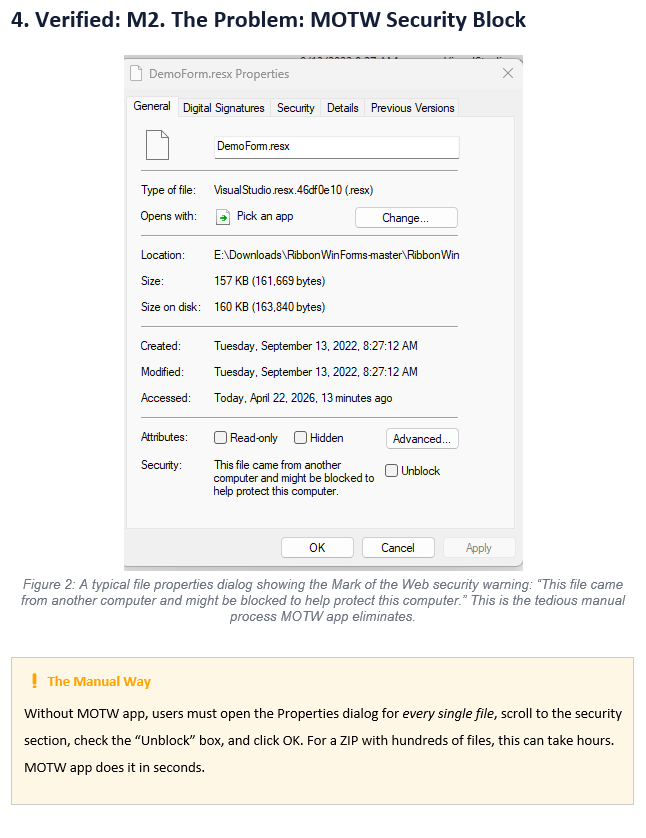
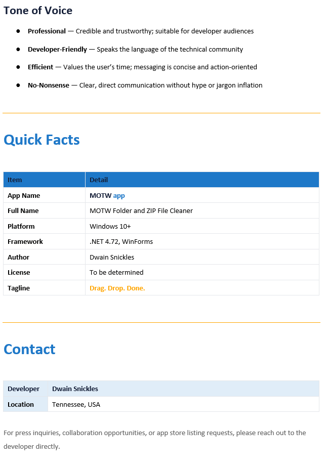

For comments, help, or improvements, use the button below:

## 📧 Email Author

## 📄 View What's New

## 📥 Download and Install MOTW Cleaner Version 1.3.2.0 on your Windows PC.

Windows Installer package (`.msi`) — installs for all users into `Program Files`, adds Start menu and desktop shortcuts, and registers in Apps & features.

## 📦 Portable Version — no install required

Single self-contained `.exe` — unzip and run on any Windows PC, no .NET install needed. Settings and recent folders are stored in `%APPDATA%\MOTW Cleaner\settings.json`, so nothing is written next to the exe.

## 🖱️ Drag and drop

Drop a **file**, a **ZIP** or a **folder** onto the MOTW Cleaner icon (or onto the drop area inside the window) and the app does the rest:

1. **It cleans.** Every file in the folder loses its Mark-of-the-Web — for a dropped file or ZIP that is the folder containing it, for a dropped folder it is that folder and all of its subfolders.
2. **It opens the folder** in File Explorer — but only while **Open Folder after cleaning** is ticked. Untick it and the drop still cleans, it just does not open anything.
3. **Nothing is created.** There is no extraction and no new folder next to the dropped item: a ZIP is unblocked where it sits, so files you extract from it later stay unblocked.
4. **The window closes itself.** A drop that launched the app (dragging onto the icon) is a one-shot job: once the folder is open, the app exits instead of sitting behind Explorer. Dropping onto an already open window keeps it open.

Each drop also triggers one background check of the published version, so a newer release is offered once per session without holding the drop up.

# MOTW Cleaner

💡

💡

💡

💡

💡

💡

💡

💡

## Support this project

If this project saved you some time, you can leave a tip at
[ko-fi.com/dwainhsnickles](https://ko-fi.com/dwainhsnickles) (cards, no account needed) or
[paypal.me/YTDPlatinum](https://paypal.me/YTDPlatinum). Bug reports and pull requests are welcome too.
